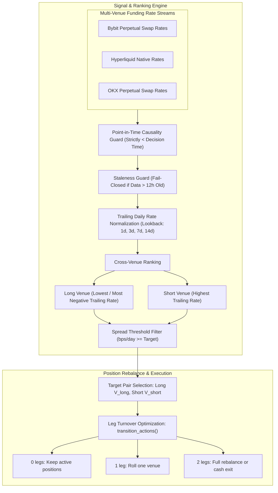

# Cross-Venue Funding Rate Dispersion Strategy Engine

[](https://www.python.org/downloads/)
[](https://opensource.org/licenses/MIT)
[](tests/)
[](docs/STRATEGY_GUIDE.md)

A deterministic, point-in-time quantitative implementation of the **Cross-Venue Funding Rate Dispersion** trading strategy across major cryptocurrency perpetual swap venues (Bybit, OKX, and Hyperliquid).

The framework captures systematic funding rate differentials between exchanges while maintaining a strict delta-neutral market stance, immune to underlying asset spot volatility.

---

## Architecture Overview



---

## Key Features

- **Strict Delta Neutrality**: Long and Short legs are sized equally, isolating pure funding yield from directional price risk.
- **Multi-Venue Normalization**: Normalizes disparate funding settlement frequencies (e.g. 8-hour intervals on Bybit/OKX vs 1-hour intervals on Hyperliquid) into standardized basis points per day (bps/day).
- **Point-in-Time Causality**: Signal evaluation strictly excludes contemporaneous or future funding payments.
- **Fail-Closed Staleness Protection**: Automatically triggers an exit to cash if funding telemetry from any participating venue lapses beyond 12 hours.
- **Turnover & Fee Minimization**: Explicitly tracks leg transitions to reduce unnecessary trading commissions when only one venue changes.

---

## Directory Structure

```
cross-venue-funding-dispersion/
├── docs/                               # Quantitative documentation
│   ├── STRATEGY_GUIDE.md               # Strategy mechanics, capital requirements & risks
│   └── DATA_SCHEMA.md                  # Multi-venue funding rate schemas
├── src/                                # Core strategy and signal modules
│   ├── __init__.py                     # Clean namespace exports
│   ├── config.py                       # Supported symbol universe and parameter grids
│   ├── models.py                       # Domain models (VenueSeries, Candidate, PairTarget)
│   ├── data_loader.py                  # In-memory and parquet funding stream ingestion
│   ├── signal_engine.py                # Trailing rate calculation, ranking & pair selection
│   └── analytics.py                    # Statistical bootstrap and dispersion metrics
├── tests/                              # Unit test suite
│   ├── __init__.py
│   └── test_funding_dispersion.py       # Unit tests verifying causality, guards & turnover
├── example_usage.py                    # Demonstration script for real-time signal generation
├── requirements.txt                    # Minimal dependencies (numpy, pandas, pyarrow, pytest)
└── README.md                           # Project documentation
```

---

## Quick Start

### 1. Installation

Clone the repository and install dependencies:

```bash
git clone https://github.com/phancongdong/cross-venue-funding-dispersion.git
cd cross-venue-funding-dispersion
pip install -r requirements.txt
```

### 2. Run Test Suite

Run the full automated test suite verifying candidate grids, timestamp parsing, causality guards, threshold filtering, and leg turnover math:

```bash
pytest tests/ -v
```

Expected output:
```
tests/test_funding_dispersion.py::test_candidate_grid PASSED
tests/test_funding_dispersion.py::test_timestamp_parser PASSED
tests/test_funding_dispersion.py::test_point_in_time_causality PASSED
tests/test_funding_dispersion.py::test_staleness_and_threshold_guards PASSED
tests/test_funding_dispersion.py::test_transition_leg_counting PASSED
tests/test_funding_dispersion.py::test_interval_rate_sum PASSED
tests/test_funding_dispersion.py::test_bootstrap_reproducibility PASSED

============================== 7 passed in 1.12s ==============================
```

### 3. Run Signal Generation Example

Run the demonstration script:

```bash
python example_usage.py
```

---

## Python API Usage

```python
import pandas as pd
from src.data_loader import create_venue_series
from src.models import Candidate, PairTarget
from src.signal_engine import target_for_decision, transition_actions

# 1. Ingest funding rate series for each venue
venues = {
    "bybit": create_venue_series("ETHUSDT", "bybit", timestamps, bybit_rates),
    "hyperliquid": create_venue_series("ETHUSDT", "hyperliquid", timestamps, hl_rates),
    "okx": create_venue_series("ETHUSDT", "okx", timestamps, okx_rates),
}

# 2. Configure strategy parameters (e.g. 3-day lookback, 2.0 bps/day spread threshold)
candidate = Candidate(lookback_days=3, threshold_bps_per_day=2.0)

# 3. Evaluate optimal delta-neutral target at decision timestamp
decision_time = pd.Timestamp("2026-07-12T00:00:00Z")
target, audit = target_for_decision(venues, decision_time, candidate)

if target is not None:
    print(f"Long Venue      : {target.long_venue.upper()}")
    print(f"Short Venue     : {target.short_venue.upper()}")
    print(f"Forecast Spread : {target.forecast_bps_per_day:.2f} bps/day")

    # 4. Compute optimal rebalance turnover
    current_target = PairTarget(long_venue="okx", short_venue="bybit", forecast_bps_per_day=1.5)
    closed_legs, opened_legs = transition_actions(current_target, target)
    print(f"Turnover Actions: Close {closed_legs} leg(s), Open {opened_legs} leg(s)")
```

---

## Quantitative Mechanics Summary

1. **Trailing Lookback Window**: Aggregates historical funding payments over rolling windows $L \in \{1, 3, 7, 14\}$ days:
   $$\text{Rate}_{\text{daily}}(v) = \frac{\sum_{t \in [T - L, T)} \text{funding\_rate}(v, t)}{L}$$
2. **Delta-Neutral Selection**:
   - **Long Leg**: Venue with the lowest trailing funding rate (receives negative funding or pays the minimum rate).
   - **Short Leg**: Venue with the highest trailing funding rate (receives positive funding or pays the minimum rate).
3. **Threshold Guard**: Only establishes positions when forecast daily spread exceeds fee hurdle:
   $$\text{Spread (bps/day)} = \left(\text{Rate}_{\text{daily}}(v_{\text{short}}) - \text{Rate}_{\text{daily}}(v_{\text{long}})\right) \times 10{,}000 \ge \text{Threshold}$$
4. **Leg Turnover Accounting**: Explicitly minimizes execution slippage by rolling only the changed leg when one venue remains optimal.

For full mathematical specifications, refer to [Strategy Guide](docs/STRATEGY_GUIDE.md) and [Data Schema](docs/DATA_SCHEMA.md).

---

## License

This project is licensed under the MIT License - see the LICENSE file for details.
